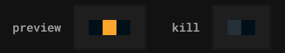
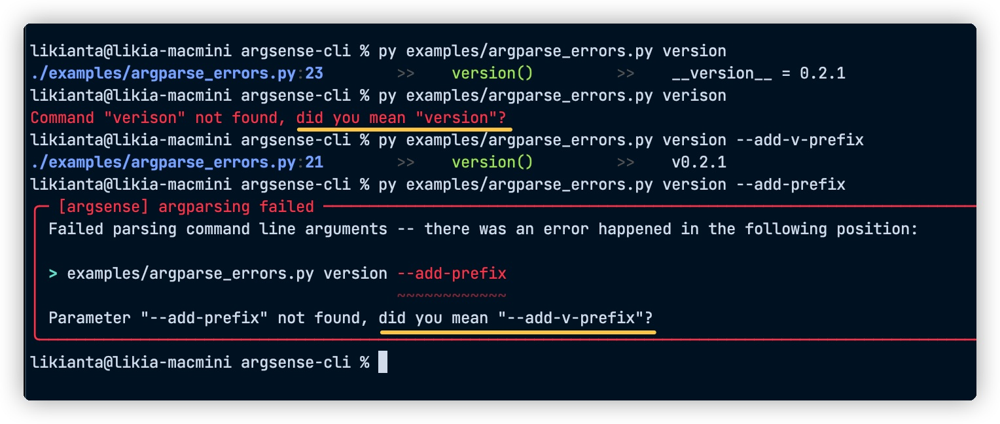
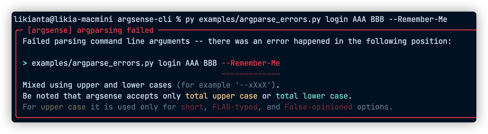
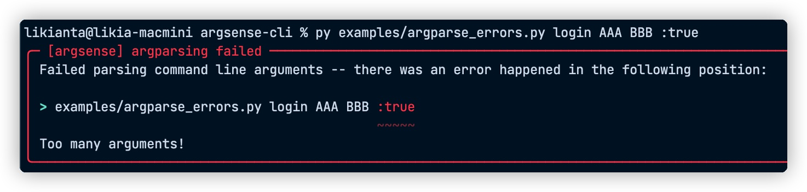

# Changelog

### 3.1.1 (WIP)

- Redirect insufficient bare invocation to help interface.
- Fix argdoc reuse.

### 3.1.0 (2026-10-23)

- Create desktop shortcuts for ArgSense GUI ports.

### 3.0.0 (2026-10-19)

- A graphical user interface (GUI), based on [streamlit-canary](https://github.com/likianta/streamlit-canary).

---

### 2.1.0 (2026-10-16)

- Triple switch on TUI for `bool | None` type.

  

### 2.0.0 (2026-10-15)

- A text user interface (TUI).
- A new color palette based on the Catppuccin theme,

---

### 1.4.0 (2026-10-15)

- Support command groups.
- Simplify the way the cli is launched.

### 1.3.2 (2026-10-14)

- Stop rendering bbcode markup by default.

### 1.3.1 (2026-10-14)

- Improve long descriptions displayed in the help interface.

### 1.3.0 (2026-10-13)

- Reuse parameter annotations.

### 1.2.0 (2026-10-13)

- Add the `cli.wrap` method.

### 1.1.2 (2026-06-30)

- Drop the lk-logger dependency.

### 1.1.1 (2026-04-08)

- Fix a possible `SystemExit` error.

### 1.1.0 (2025-08-08)

- Add the loop mode, `:loop`.
- Provide an easy-to-use interface for scripted calls.

### 1.0.1 (2025-07-25)

- A parameter is now allowed to occupy `-h`, and it is escaped to "help" at the
  right moment.

### 1.0.0 (2025-06-05)

Version 0.7 has been widely validated and used for a long time, so we now move
the version number to 1.0.

Note that this version is not noticeably different from 0.7.2 - you can move
from 0.7 to it smoothly.

- Update the help interface options in the config.
- A few edge fixes.

---

### 0.7.2 (2025-04-11)

- Simplify the decorator: use `@cli` instead of `@cli.cmd()`.

### 0.7.1 (2025-02-19)

- Fix the parsing of `sys.argv`.
- Fix the call of a function that takes no parameter.

### 0.7.0 (2025-02-08)

- Non-intrusive script invocation.

---

### 0.6.4 (2025-01-17)

- Improve the parameter descriptions of the help interface.
- Fix `python -m <package>` on Python 3.8.

### 0.6.3 (2025-01-03)

- Fix `sys.argv` related problems.

### 0.6.2 (2024-12-26)

- Accept a function name in snake_case.

### 0.6.1 (2024-12-24)

- Update the handling of a function that takes no parameter.

### 0.6.0 (2024-12-19)

- A new command line help interface.
- Improve the docstring parser.

---

### 0.5.8 (2024-06-18)

- Support the traceback feature of lk-logger.

### 0.5.7 (2024-04-11)

- Fix Python 3.8 compatibility.

### 0.5.6 (2024-01-19)

- Fix the error that a global parameter caused to the help command.

### 0.5.5 (2024-01-02)

- Add `:empty` for passing an empty string.
- Fix the handling of `*args`.

### 0.5.4 (2023-11-03)

- Fix `args` that could not be passed by the kwargs syntax.

### 0.5.3 (2023-10-05)

- No longer warn about a duplicated (i.e. `@cli.cmd()` decorated) function by
  default.

### 0.5.2 (2022-11-21)

- `:help` / `:helpx` are handled globally first.
- Special handling of the parameter names that start with an underscore.

### 0.5.1 (2022-11-21)

- Fix a type parsing error.

### 0.5.0 (2022-11-20)

- Support the `*args` and `**kwargs` parameters.
- Better unit tests.

---

### 0.4.3 (2022-11-12)

- Style adjustments.
- Other optimizations.

### 0.4.2 (2022-08-30)

Fix Python 3.8 compatibility.

### 0.4.1 (2022-07-26)

Fix a type checking error.

### 0.4.0 (2022-07-24)

An option parameter is now allowed to be passed "anonymously".

```sh
# before
python3 login.py username --password 123456

# after
python3 login.py username 123456
```

---

### 0.3.1

Fixed a few details.

### 0.3.0

Optimized the text colors, so that the text feels consistent (and looks better)
under different terminal themes.

---

### 0.2.2

Strengthened the parameter type conversion.

### 0.2.1

The "did-you-mean" feature:



### 0.2.0

Improved the way a command line argument error is reported.

Now, when an error occurs, the position of the parameter, the reason of the
error and other information are provided, as shown below:





---

### 0.1.2

Adjusted the output style.

Some details worth noting:

- Fixed the argument passing problem: it turned out that the previous version
  could hardly work with normal arguments.
- The field width alignment strategy was relaxed, which made the result look
  better.
- A flexible header style: taking practical situations into account (for
  example, when one wants to copy the header as the next command), it now fits
  the real needs better.
- The home page documentation got the latest screenshots.

### 0.1.1

An empty argument falls back to the help command.

### 0.1.0

The basic features of argsense are verified.

Importantly, the `help` and `helpx` commands and their outputs work as
expected.
