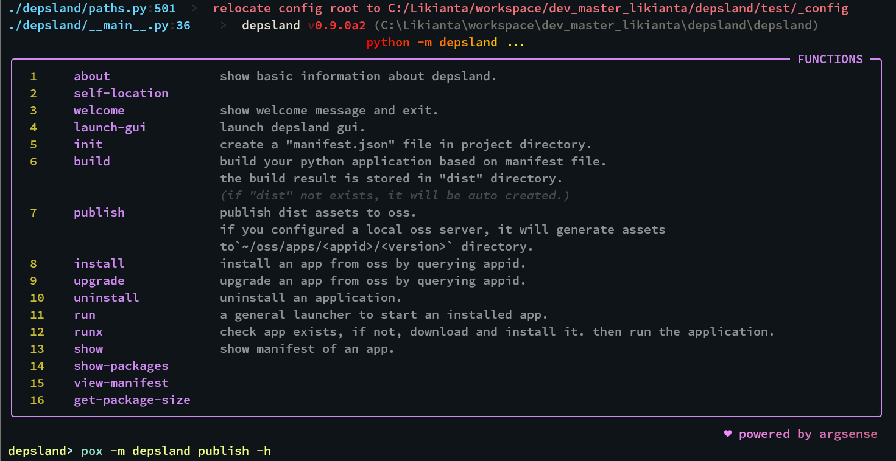
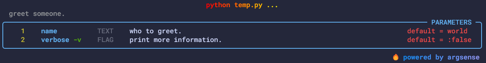
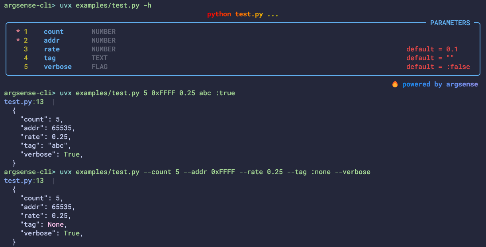
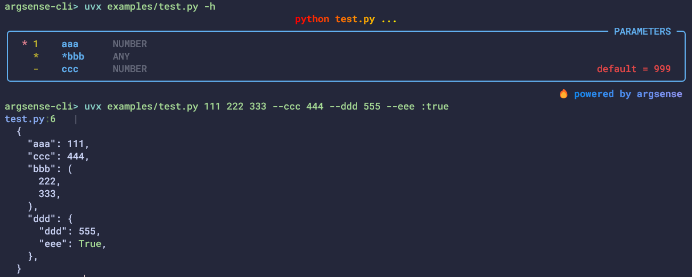
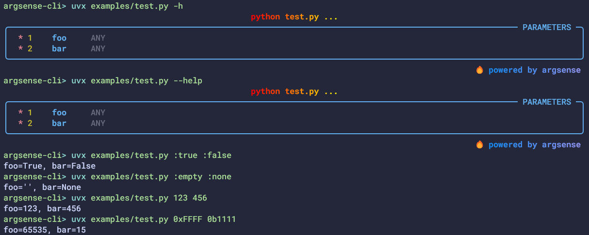
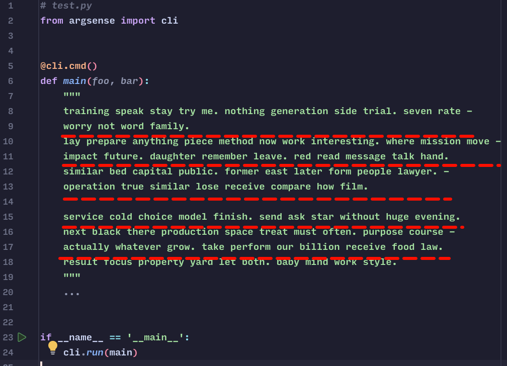
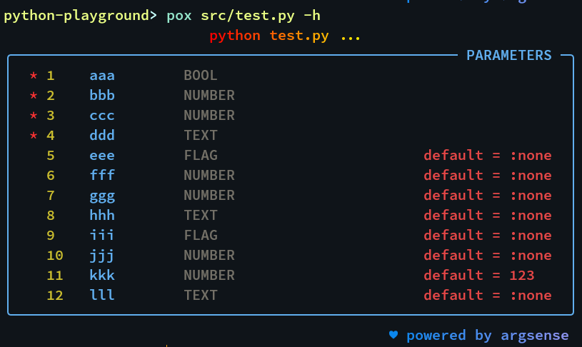

# Argsense CLI

[](https://badge.fury.io/py/argsense) [](https://pepy.tech/project/argsense) [](https://pepy.tech/project/argsense)

[中文版](https://blog.csdn.net/Likianta/article/details/144585120)

**ArgSense** is a command line interface (CLI) toolkit for Python programmers.

It is much lighter than [argparse](#argparse-standard-library), [Click](#click) and [Typer](#typer), and closest in spirit to [yapx](https://www.fresh2.dev/r/yapx/). If you are already used to another CLI library, jump to [Comparison with Other Libraries](#comparison-with-other-libraries) to see how ArgSense differs.

Screenshots:





## Highlights

- Python first. ArgSense takes `:true` `:false` `:none` from CLI and convert them to direct Python types.
- Intuitive. It gets all information from the function signature and docstrings.
- Less peripheral code.
- Rich panel of help interface.

## Comparison with Other Libraries

> The Python ecosystem already has many mature CLI libraries. This chapter walks through a few common scenarios and implements each of them with ArgSense and its most popular alternatives, so that you can see the differences side by side. Except for the "[Hello World](#the-hello-world-case)" case, each scenario only shows one to three representative competitors — nobody enjoys reading the same comparison nine times.

### The "Hello World" Case

#### ArgSense

```python
from argsense import cli

@cli
def hello(name: str = 'world'):
    print(f'hello {name}')

if __name__ == '__main__':
    cli.run(hello)
```

```shell
# get help
python main.py -h
python main.py hello -h

# run with default name
python main.py hello

# run with given name
python main.py hello Alice
python main.py hello --name Alice
```

#### argparse (standard library)

[argparse](https://docs.python.org/3/library/argparse.html) is the standard-library solution. The interface is declared imperatively, and help text is passed explicitly.

```python
import argparse

def hello(name: str = 'world'):
    print(f'hello {name}')

if __name__ == '__main__':
    parser = argparse.ArgumentParser()
    parser.add_argument('name', nargs='?', default='world', help='Who to greet.')
    args = parser.parse_args()
    hello(name=args.name)
```

#### Click

[Click](https://click.palletsprojects.com/) uses decorators to declare commands and parameters, and generates a nicely formatted help page.

```python
import click

@click.command()
@click.option('--name', default='world', help='Who to greet.')
def hello(name: str) -> None:
    click.echo(f'hello {name}')

if __name__ == '__main__':
    hello()
```

#### Typer

[Typer](https://typer.tiangolo.com/) is built on top of Click and infers the interface from type hints.

```python
import typer

def hello(name: str = 'world'):
    print(f'hello {name}')

if __name__ == '__main__':
    typer.run(hello)
```

#### Python Fire

[Python Fire](https://github.com/google/python-fire) (originally released by Google) turns almost any Python object into a CLI with a single call.

```python
import fire

def hello(name: str = 'world'):
    print(f'hello {name}')

if __name__ == '__main__':
    fire.Fire(hello)
```

#### docopt

[docopt](http://docopt.org/) generates the parser from a usage message written in the docstring. All values are received as plain strings.

```python
"""Greet someone.

Usage:
    hello.py <name>
"""
from docopt import docopt

if __name__ == '__main__':
    arguments = docopt(__doc__)
    print(f"hello {arguments['<name>']}")
```

#### clize

[clize](https://clize.readthedocs.io/) derives the interface from type hints and the docstring, in a spirit close to ArgSense.

```python
from clize import run

def hello(name: str = 'world'):
    """Greet someone.

    :param name: Who to greet.
    """
    print(f'hello {name}')

if __name__ == '__main__':
    run(hello)
```

#### cyclopts

[cyclopts](https://cyclopts.readthedocs.io/) is a modern, type-hint-driven library with rich help output.

```python
from cyclopts import App

app = App()

@app.default
def hello(name: str = 'world'):
    print(f'hello {name}')

if __name__ == '__main__':
    app()
```

#### defopt

[defopt](https://pypi.org/project/defopt/) builds the CLI from type hints and a reStructuredText-style docstring.

```python
import defopt

def hello(name: str = 'world'):
    """Greet someone.

    :param name: Who to greet.
    """
    print(f'hello {name}')

if __name__ == '__main__':
    defopt.run(hello)
```

### Rich, Docstring-driven Help

#### ArgSense

ArgSense reads the whole help page from the function's docstring: the command description, each parameter's help, the short option and even the default value. There is nothing to repeat in code.

```python
from argsense import cli

@cli
def hello(name: str = 'world', *, verbose: bool = False):
    """
    greet someone.

    params:
        name: who to greet.
        verbose (-v): print more information.
    """
    ...

if __name__ == '__main__':
    cli.run(hello)
```

Screenshot (`python temp.py -h`):



#### Click

Click takes the docstring as the command description, but each parameter's help still has to be written in its decorator.

```python
import click

@click.command()
@click.option('--name', default='world', help='Who to greet.')
@click.option('--verbose', '-v', is_flag=True, help='Print more information.')
def hello(name: str, verbose: bool) -> None:
    """Greet someone."""
    click.echo(f'hello {name}')

if __name__ == '__main__':
    hello()
```

#### Typer

Typer does the same: the docstring is the description, while per-parameter help is given in `typer.Option` / `typer.Argument`.

```python
import typer

def hello(
    name: str = 'world',
    verbose: bool = typer.Option(
        False, '--verbose', '-v', help='Print more information.'
    ),
):
    """Greet someone."""
    print(f'hello {name}')

if __name__ == '__main__':
    typer.run(hello)
```

### Handling Long Descriptions

> A long parameter description is a common challenge for any help interface. Most CLI libraries simply wrap it inside the narrow "help" column, which produces a tall, ragged block that is hard to scan, and leaves a lot of blank space under the parameter name and type. ArgSense notices when the description column is too cramped and gives the description a full-width line of its own.

The same command, defined in ArgSense (the libraries below implement the exact same command):

```python
from argsense import cli

@cli
def install(appid: str, version: str = '', use_exist: bool = True):
    """
    install an app.

    params:
        appid: the app id (a normalized app name).
        version: the app version to operate on.
            if not given, the last installed version will be used.
        use_exist (-u):
            1. if `version` is not given, will try to use the last installed -
            version.
            2. if `version` is given, but not installed, and if depsland finds
            a newer version already installed, will use the newer one.
                why we do this: due to the design limitation, the cloud drive -
                stores only one "latest" version on the oss side; older -
                versions are discarded as soon as a new version is published. -
                this means user can never retrieve a specific older version at -
                that time. we have to force user to use the newer one.
    """
```

**ArgSense** — the description gets a full-width line of its own:

```text
                       python long_desc_argsense.py ...
  install an app.
┌──────────────────────────────────────────────────────────────── PARAMETERS ─┐
│  * 1    appid        TEXT                                                   │
│         the app id (a normalized app name).                                 │
│                                                                             │
│    2    version      TEXT                                     default = ""  │
│         the app version to operate on.                                      │
│         if not given, the last installed version will be used.              │
│                                                                             │
│    3    use-exist -u FLAG                                  default = :true  │
│         1. if `version` is not given, will try to use the last installed    │
│         version.                                                            │
│         2. if `version` is given, but not installed, and if depsland finds  │
│         a newer version already installed, will use the newer one.          │
│             why we do this: due to the design limitation, the cloud drive   │
│             stores only one "latest" version on the oss side; older         │
│             versions are discarded as soon as a new version is published.   │
│             this means user can never retrieve a specific older version at  │
│             that time. we have to force user to use the newer one.          │
└─────────────────────────────────────────────────────────────────────────────┘
                                                        🔥 powered by argsense
```

**argparse** — the description is wrapped into the narrow help column:

```text
usage: install [-h] [--version VERSION] [--use-exist] appid

install an app.

positional arguments:
  appid              the app id (a normalized app name).

options:
  -h, --help         show this help message and exit
  --version VERSION  the app version to operate on. if not given, the last
                     installed version will be used.
  --use-exist, -u    1. if `version` is not given, will try to use the last
                     installed version. 2. if `version` is given, but not
                     installed, and if depsland finds a newer version already
                     installed, will use the newer one. why we do this: due to
                     the design limitation, the cloud drive stores only one
                     "latest" version on the oss side; older versions are
                     discarded as soon as a new version is published. this
                     means user can never retrieve a specific older version at
                     that time. we have to force user to use the newer one.
```

**Click** — same wrapping behavior:

```text
Usage: long_desc_click.py [OPTIONS] APPID

  install an app.

Options:
  --version TEXT   the app version to operate on. if not given, the last
                   installed version will be used.
  -u, --use-exist  1. if `version` is not given, will try to use the last
                   installed version. 2. if `version` is given, but not
                   installed, and if depsland finds a newer version already
                   installed, will use the newer one. why we do this: due to
                   the design limitation, the cloud drive stores only one
                   "latest" version on the oss side; older versions are
                   discarded as soon as a new version is published. this means
                   user can never retrieve a specific older version at that
                   time. we have to force user to use the newer one.
  --help           Show this message and exit.
```

**Typer** — rich panels, but the description column is still narrow:

```text
 Usage: long_desc_typer.py [OPTIONS] {appid}

 install an app.

┌─ Arguments ─────────────────────────────────────────────────────────────────┐
│ *    appid      <str>  [required]                                           │
└─────────────────────────────────────────────────────────────────────────────┘
┌─ Options ───────────────────────────────────────────────────────────────────┐
│ --version            <str>  the app version to operate on. if not given,    │
│                             the last installed version will be used.        │
│ --use-exist  -u             1. if `version` is not given, will try to use   │
│                             the last installed version. 2. if `version` is  │
│                             given, but not installed, and if depsland finds │
│                             a newer version already installed, will use the │
│                             newer one. why we do this: due to the design    │
│                             limitation, the cloud drive stores only one     │
│                             "latest" version on the oss side; older         │
│                             versions are discarded as soon as a new version │
│                             is published. this means user can never         │
│                             retrieve a specific older version at that time. │
│                             we have to force user to use the newer one.     │
│                             [default: True]                                 │
│ --help                      Show this message and exit.                     │
└─────────────────────────────────────────────────────────────────────────────┘
```

**cyclopts** — the description column is even narrower:

```text
Usage: install APPID [ARGS]

install an app.

┌─ Commands ──────────────────────────────────────────────────────────────────┐
│ --help (-h)  Display this message and exit.                                 │
│ --version    Display application version.                                   │
└─────────────────────────────────────────────────────────────────────────────┘
┌─ Parameters ────────────────────────────────────────────────────────────────┐
│ *  APPID --appid             the app id (a normalized app name). [required] │
│    VERSION --version         the app version to operate on. if not given,   │
│                              the last installed version will be used.       │
│                              [default: ""]                                  │
│    USE-EXIST --use-exist -u                                                 │
│      --no-use-exist           1 if version is not given, will try to use    │
│                                 the last installed version. 2. if version   │
│                                 is given, but not installed, and if         │
│                                 depsland finds a newer version already      │
│                                 installed, will use the newer one. why we   │
│                                 do this: due to the design limitation, the  │
│                                 cloud drive stores only one "latest"        │
│                                 version on the oss side; older versions are │
│                                 discarded as soon as a new version is       │
│                                 published. this means user can never        │
│                                 retrieve a specific older version at that   │
│                                 time. we have to force user to use the      │
│                                 newer one. [default: True]                  │
└─────────────────────────────────────────────────────────────────────────────┘
```

### Hidden Description

> A docstring usually carries more than the parameter list — usage notes, references, examples, and so on. ArgSense shows only the top description and the `params:` section in the help interface; whatever follows them is treated as private and hidden. Libraries that reuse the raw docstring as the help text instead dump those extra sections into the output, which is noisy and often loses the original layout.

Take the following function. The `notes:` and `references:` sections are not part of the help interface:

```python
def foo(aaa: str, bbb: bool = False):
    """
    do something meaningful.

    params:
        aaa: the description of aaa.
        bbb: the description of bbb.

    notes:
        this section should not appear in the help interface.

    references:
        - `http://example.com`
        - `http://example.org`
    """
```

**ArgSense** — only the top description and the parameters are shown:

```text
                      python hidden_desc_argsense.py ...
  do something meaningful.
┌──────────────────────────────────────────────────────────────── PARAMETERS ─┐
│  * 1    aaa  TEXT                                                           │
│         the description of aaa.                                             │
│                                                                             │
│    2    bbb  FLAG                                         default = :false  │
│         the description of bbb.                                             │
└─────────────────────────────────────────────────────────────────────────────┘
                                                        🔥 powered by argsense
```

**Click** — the raw docstring is used as the help text, so the extra sections leak into the output (and their layout is collapsed):

```text
Usage: hidden_desc_click.py [OPTIONS] AAA

  do something meaningful.

  notes:     this section should not appear in the help interface.

  references:     - http://example.com     - http://example.org

Options:
  --bbb   the description of bbb.
  --help  Show this message and exit.
```

### Multiple Commands in One File

#### ArgSense

Decorate every function with `@cli`, then call `cli.run()` without an argument. `python main.py -h` lists all commands, and `python main.py <cmd> -h` shows one.

```python
from argsense import cli

@cli
def foo(a: str):
    ...

@cli
def bar(b: int):
    ...

if __name__ == '__main__':
    cli.run()
```

```shell
python main.py -h
python main.py foo -h
python main.py foo 123
python main.py bar -h
python main.py bar 456
```

#### Click

```python
import click

@click.group()
def cli():
    pass

@cli.command()
def foo(a: str):
    ...

@cli.command()
def bar(b: int):
    ...

if __name__ == '__main__':
    cli()
```

#### Typer

```python
import typer

app = typer.Typer()

@app.command()
def foo(a: str):
    ...

@app.command()
def bar(b: int):
    ...

if __name__ == '__main__':
    app()
```

### Parameter Types and Special Values

#### ArgSense

ArgSense infers a parameter's type from its annotation, converts the input accordingly, and additionally understands a set of special values.

```python
from argsense import cli

@cli
def train(
    count: int, 
    addr: int, 
    rate: float = 0.1, 
    tag: str = '', 
    verbose: bool = False
):
    ...

if __name__ == '__main__':
    cli.run(train)
```

```shell
python main.py -h
python main.py 5 0xFFFF 0.25 abc :true  # positional args
python main.py --count 5 --addr 0xFFFF --rate 0.25 --tag abc --verbose  # keyword args
python main.py --count 5 --addr 0xFFFF --rate 0.25 --tag :empty --verbose  # empty string
python main.py --count 5 --addr 0xFFFF --rate 0.25 --tag :none --verbose  # None type
```



| User input | Recognized as       |
| ---------- | ------------------- |
| `:true`    | `True`              |
| `:false`   | `False`             |
| `:none`    | `None`              |
| `:empty`   | `''` (empty string) |

See [Passing Special Values](#passing-special-values) for the full rules.

#### argparse

argparse requires you to spell out every `type=` and `action=`, and it has no notion of "special values": the literal text `:none` would simply stay the string `":none"` unless you convert it yourself.

```python
parser.add_argument('count', type=int)
parser.add_argument('--rate', type=float, default=0.1)
parser.add_argument('--tag', default='')
parser.add_argument('--verbose', action='store_true')
```

#### Typer

Typer, like ArgSense, infers types from the annotations — but it does not provide `:none` / `:empty` sentinels out of the box.

```python
def train(count: int, rate: float = 0.1, tag: str = '', verbose: bool = False):
    ...
```

### `*args` and `**kwargs`

#### ArgSense

```python
from argsense import cli
from neoprint import print

@cli
def foo(aaa: int, *bbb, ccc: int = 999, **ddd):
    print(locals(), ':l')

cli.run(foo)
```

```shell
python main.py -h
python main.py 111 222 333 --ccc 444 --ddd 555 --eee :true
```



#### Click

Click supports variadic *positional* arguments via `nargs=-1`, but it cannot accept arbitrary extra `--keyword` arguments — every option has to be declared upfront.

```python
import click

@click.command()
@click.argument('aaa', type=int)
@click.argument('bbb', nargs=-1, type=int)
@click.option('--ccc', type=int, default=999)
def foo(aaa: int, bbb: tuple, ccc: int) -> None:
    click.echo((aaa, bbb, ccc))

if __name__ == '__main__':
    foo()
```

#### Typer

In Typer, a parameter annotated as `List[...]` becomes a variadic positional argument.

```python
import typer
from typing import List

def foo(aaa: int, bbb: List[int], ccc: int = 999):
    print(aaa, bbb, ccc)

if __name__ == '__main__':
    typer.run(foo)
```

Neither Click nor Typer accepts arbitrary extra `--keyword` options the way ArgSense's `**kwargs` does.

### Reusable Parameter Annotations

#### ArgSense

When several commands share the same parameter, you only need to document it once. Write the full description in the first function, and let the others reference it with `` see `@<command>:<parameter>` ``:

```python
from argsense import cli

@cli
def foo(name: str, age: int):
    """
    params:
        name: the leader's name.
        age: the leader's age.
    """

@cli
def bar(name: str, age: int):
    """
    params:
        name: see `@foo:name`
        age: see `@foo:age`
    """
```

The reference is resolved lazily, so the registration order does not matter, and references can even be chained (`bar` -> `foo` -> ...). If a referenced command or parameter does not exist, the text is left untouched.

#### Click

Other libraries have no docstring-level reference. The usual workaround is to extract a shared decorator (or a type alias, in Typer) and reuse it in code:

```python
import click

def name_option(func):
    return click.option('--name', help="the leader's name.")(func)

@click.command()
@name_option
def foo(name): ...

@click.command()
@name_option
def bar(name): ...
```

### At a Glance

| Library         | How the interface is declared  | Help text source            | Automatic type conversion | Multiple commands        | Help UI              |
| --------------- | ------------------------------ | --------------------------- | ------------------------- | ------------------------ | -------------------- |
| `argparse`      | imperative (`add_argument`)    | `help=` arguments           | manual (`type=`)          | subparsers               | plain                |
| `click`         | decorators (`@click.option`)   | `help=` + docstring         | manual (`type=`)          | `@click.group`           | pretty               |
| `typer`         | type hints                     | `Annotated` + docstring     | yes                       | `Typer` app              | rich (via Click)     |
| `python-fire`   | function signature             | docstring                   | yes                       | dict / class             | plain                |
| `docopt`        | docstring DSL                  | the docstring               | no (all strings)          | usage patterns           | plain                |
| `clize`         | type hints + docstring         | docstring                   | yes                       | `run`                    | decent               |
| `cyclopts`      | type hints                     | `Annotated` + docstring     | yes                       | `App`                    | rich                 |
| `defopt`        | type hints + reST docstring    | reST docstring              | yes                       | function list            | plain                |
| **`argsense`**  | type hints + docstring         | docstring (`params:`)       | yes                       | `@cli` commands          | rich                 |

## Install

ArgSense supports Python 3.9 and above:

```shell
pip install argsense
```

The latest version is 1.2+.

## Quick Start

```python
from argsense import cli
from typing import Any

@cli
def main(foo: Any, bar: Any):
    print(f'{foo=}, {bar=}')

if __name__ == '__main__':
    cli.run(main)
```

```shell
python main.py -h
python main.py --help
python main.py Foo Bar
python main.py :true :false
python main.py :empty :none
python main.py 123 456
python main.py 0xFFFF 0b1111
```



That is all you need: decorate the function with `@cli`, then call `cli.run()`. The parameter list, the help text and the type conversion are all derived from the signature and the docstring. See [Comparison with Other Libraries](#comparison-with-other-libraries) for the big picture, and [In-Depth Reading](#in-depth-reading) for the details.

## In-Depth Reading

### The Format of a Function Docstring

- Blank lines between text lines are optional. If present, they are preserved as-is, and consecutive blank lines are rendered as consecutive blank lines.
- A line that is too long can be continued by ending it with `-`:

  ```python
  # test.py
  from argsense import cli

  @cli
  def main(foo, bar):
      """
      training speak stay try me. nothing generation side trial. seven rate -
      worry not word family.
      lay prepare anything piece method now work interesting. where mission -
      move impact future. daughter remember leave. red read message talk hand.
      similar bed capital public. former east later form people lawyer. -
      operation true similar lose receive compare how film.

      service cold choice model finish. send ask star without huge evening.
      next black there production space treat must often. purpose course -
      actually whatever grow. take perform our billion receive food law.
      result focus property yard let both. baby mind work style.
      """
      ...

  if __name__ == '__main__':
      cli.run(main)
  ```

  

  
- Parameter annotations must start with the `params:` field.
- The format of a parameter annotation is:

  ```
  <param_name> (<short_name>): <first_line_of_description>
      <more_description_lines>
  ```

  - `param_name` must be a parameter that appears in the function. If a non-existent name is used and the function has no `**kwargs`, an error is raised.
  - `short_name` must start with a hyphen, followed by **a lowercase letter** and zero or more digits, for example:

    ```
    # correct
    -a
    -a1
    -a123

    # incorrect
    -A
    -A0
    -Abc
    -ABC
    ```
  - `first_line_of_description` is optional; if the description is short, write it here.

    If you leave this field blank, you can write the description in `more_description_lines` instead:

    ```python
    def foo(...):
        """
        params:
            aaa: degree serve across recently.
            bbb:
                least support seem success word.
        """
    ```

    

    If the text is long and there is not enough space on the `first_line_of_description`, write it in `more_description_lines` instead:

    ```python
    def foo(...):
        """
        params:
            aaa: degree serve across recently.
            bbb:
                least support seem success word.
            ccc:
                scientist do war statement pay or reflect. fill -
                get skill scene medical. side generation energy -
                but popular. ago war act nice down.
        """
    ```

### Supported Parameter Types

ArgSense supports a limited set of types. Any unsupported type is treated as "any".

The supported types are as follows:

- bool
- float
- int
- str

They can also be wrapped with `typing.Optional[...]`, as shown in the following example:

```python
import typing as t
from argsense import cli

@cli
def main(
    aaa: bool,
    bbb: float,
    ccc: int,
    ddd: str,
    eee: bool = None,
    fff: float = None,
    ggg: int = None,
    hhh: str = None,
    iii: t.Optional[bool] = None,
    jjj: t.Optional[float] = None,
    kkk: t.Optional[int] = 123,
    lll: t.Optional[str] = None,
):
    ...

if __name__ == '__main__':
    cli.run(main)
```



#### `int`, `float`

Both int and float are treated as `NUMBER`.

ArgSense handles `NUMBER` types flexibly. Besides plain numbers, you can pass any numeric literal that Python accepts, such as binary `0b1010` / `0b1100_0011` or hexadecimal `0xAF2C` / `0xFF36_A2B2`.

All of them are parsed into the corresponding int/float values.

#### `str`

...

#### `Optional[...]`

...

#### What Happens When a Wrong Type Is Passed?

...

### Passing Special Values

ArgSense supports converting the following inputs into specific Python values:

| User input | Recognized as       |
| ---------- | ------------------- |
| `:true`    | `True`              |
| `:false`   | `False`             |
| `:none`    | `None`              |
| `:empty`   | `''` (empty string) |

**Passing Boolean Values**

The usage of boolean values (`:true` `:false`) is rather special. Please refer to the following example to understand it:

```python
# test.py
from argsense import cli

@cli
def main(foo: bool, bar: bool):
    """
    params:
        foo (-f):
        bar (-b):
    """
    ...

if __name__ == '__main__':
    cli.run(main)
```

To pass `True`, the following are equivalent:

```shell
python test.py :true :true
python test.py --foo --bar
python test.py -f -b
```

They are parsed as `main(foo=True, bar=True)`.

Note that you cannot write `python test.py --foo :true --bar :true`, because `--foo` on its own already means `foo=True`. This is ArgSense's special treatment of boolean values.

To represent `False`, the following are equivalent:

```shell
python test.py :false :false
python test.py --no-foo --no-bar
python test.py --not-foo --not-bar
```

This is parsed as `main(foo=False, bar=False)`.

Note the `--no-foo` / `--not-foo` syntax. 

The abbreviation in `foo (-f)` must be lowercase (otherwise ArgSense reports a parsing error), so the docstring never mixes uppercase and lowercase. Uppercase is reserved to mean "not".

Downside: because of this design, ArgSense cannot handle certain parameter names. For example, `def main(no_alpha: bool)` makes `--no-alpha` parse incorrectly and raise an error.

### `*args` and `**kwargs`

ArgSense supports passing `*args` and `**kwargs`, and its usage is intuitive. See the following example:

```python
# test.py
from argsense import cli

@cli
def main(aaa, *bbb, ccc=123, **ddd) -> None:
    print(f'{aaa=}, {bbb=}, {ccc=}, {ddd=}')

if __name__ == '__main__':
    cli.run(main)
```


## Frequently Asked Questions

**Q: What are the advantages of ArgSense, compared to argparse, Click, Typer, Python Fire and other libraries?**

See [Comparison with Other Libraries](#comparison-with-other-libraries). In short: ArgSense keeps the simplicity of `python-fire` (write a normal function, get a CLI), while adopting the docstring-driven, type-hint-based interface and the rich help UI of `typer`/`click`. It also adds a few features the others do not have, such as [reusable parameter annotations](#reusable-parameter-annotations) and [special value conversion](#passing-special-values).

**Q: How to pass a complex type parameter?**

...

**Q: When there are too many functions, I want to group them. How can I do it?**

...

**Q: Why is ArgSense not designed to follow traditional command line usage?**

...
