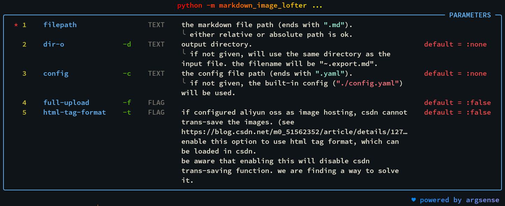
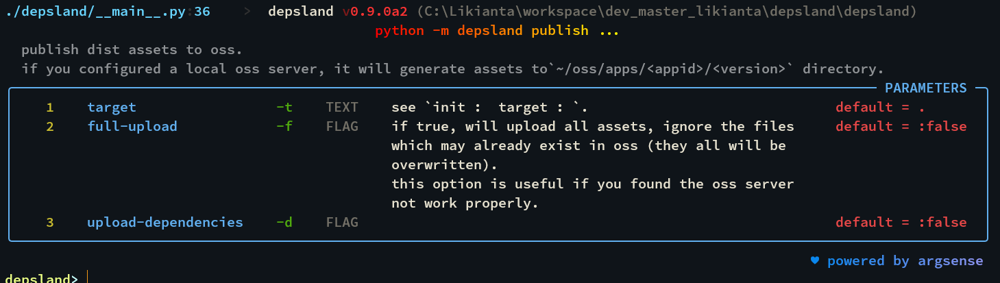
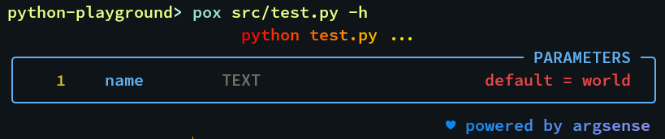
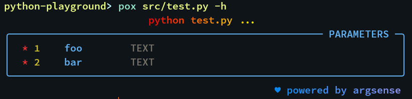
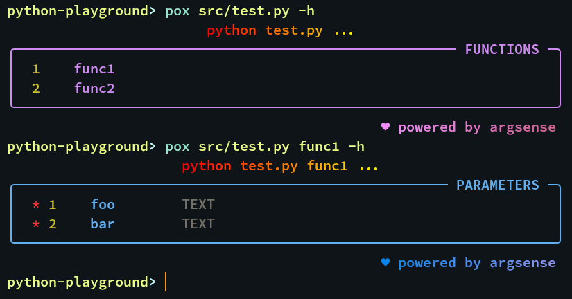
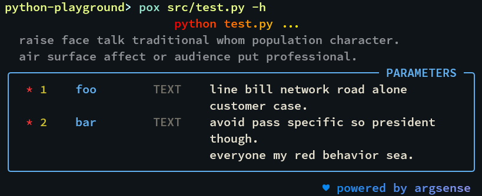
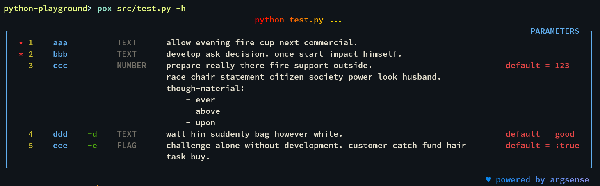
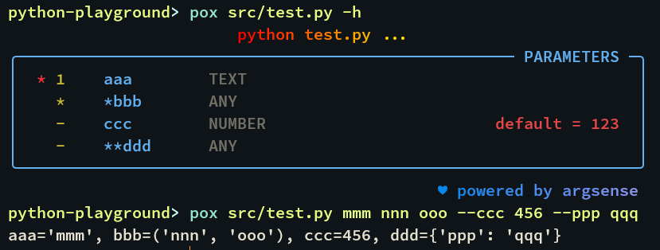
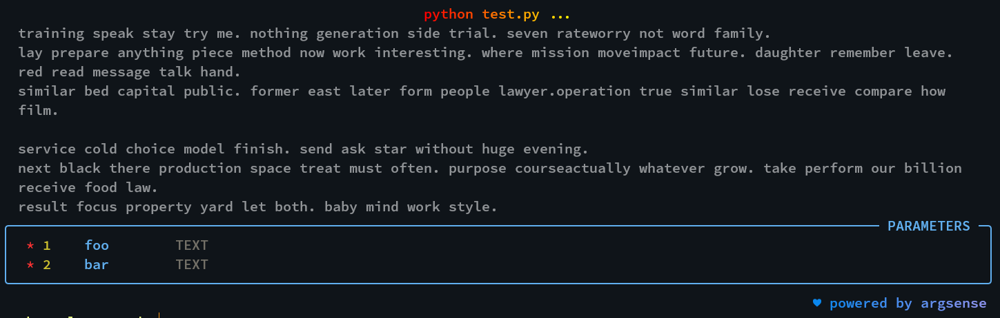
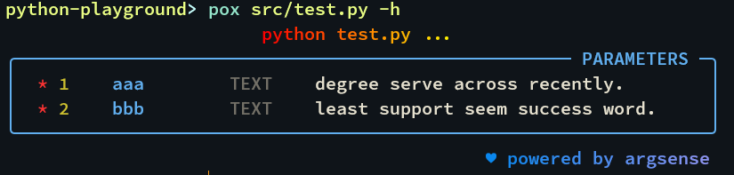

# Argsense CLI

[](https://badge.fury.io/py/argsense) [](https://pepy.tech/project/argsense) [](https://pepy.tech/project/argsense)

[中文版](https://blog.csdn.net/Likianta/article/details/144585120)

**ArgSense** is a command line interface (CLI) toolkit for Python programmers.

It is much lighter than [argparse](#argparse-standard-library), [Click](#click) and [Typer](#typer), and closest in spirit to [yapx](https://www.fresh2.dev/r/yapx/). See [Comparison with Other Libraries](#comparison-with-other-libraries) for details.

Screenshots:






A quick look at the code:

- Using `argparse`:

  ```python
  from argparse import ArgumentParser

  def hello(name: str = 'world'):
      print(f'hello {name}')

  parser = ArgumentParser()
  parser.add_argument('--name', default='world')

  parsed_args = parser.parse_args()

  hello(name=parsed_args.name)
  ```

- Using `argsense`:

  ```python
  from argsense import cli

  @cli
  def hello(name: str = 'world'):
      print(f'hello {name}')

  cli.run(hello)
  ```

  ... and it prints a much more beautiful help interface:

  

## Install

ArgSense supports Python 3.9 and above:

```shell
pip install argsense
```

The latest version is 1.2+.

## Quick Start

> Note: some code examples use randomly generated words that have no actual meaning. They are only there to help you understand the overall code structure.

### Decorate a Function

```python
# test.py
from argsense import cli

@cli
def main(foo, bar):
    ...

if __name__ == '__main__':
    cli.run(main)
```



Explanation:

- Import the module with `from argsense import cli`.
- Decorate the target function with `@cli`.
- Call `cli.run(<entrance_func>)` to start.

### Decorate Multiple Functions

```python
# test.py
from argsense import cli

@cli
def func1(foo, bar):
    ...

@cli
def func2(foo, bar):
    ...

if __name__ == '__main__':
    cli.run()
```



Explanation:

- Decorate every function with `@cli`.
- Call `cli.run()` (without an argument) instead of `cli.run(<entrance_func>)`, so that the function name can be passed on the command line.
- `python test.py -h` shows the help for all functions; `python test.py <func> -h` shows the help for a specific function.

### Help Interface Documentation

ArgSense parses a function's docstring and extracts the function description, parameter descriptions and other information from it.

```python
# test.py
from argsense import cli

@cli
def main(foo, bar):
    """
    raise face talk traditional whom population character.
    air surface affect or audience put professional.

    params:
        foo: line bill network road alone customer case.
        bar: avoid pass specific so president though.
            everyone my red behavior sea.

    so job able far heart fund weight. family later energy -
    community beautiful other tv.

    reference links:
        - https://campos.com/f132eb1dbd2511efb10300155db7dfe7
        - http://woods.com/f58e8e41bd2511efae3600155db7dfe7
        - http://www.barry.com/f5de9271bd2511efa59600155db7dfe7
    """
    ...

if __name__ == '__main__':
    cli.run(main)
```



Explanation:

- The first few lines of text are used as the function description. Once another field appears on a line, the remaining text is no longer treated as part of the description.
- Parameter descriptions begin with the `params:` field; the field name is case-insensitive.

### Optional Parameters

```python
# test.py
from argsense import cli

@cli
def main(aaa, bbb, ccc=123, ddd='good', eee=True):
    """
    params:
        aaa: allow evening fire cup next commercial.
        bbb: develop ask decision. once start impact himself.
        ccc: prepare really there fire support outside.
            race chair statement citizen society power look husband.
            though-material:
                - ever
                - above
                - upon
        ddd (-d): wall him suddenly bag however white.
        eee (-e):
            challenge alone without development. customer catch fund -
            hair task buy.
    """
    ...

if __name__ == '__main__':
    cli.run(main)
```



Explanation:

- A red asterisk is displayed on the left of each required parameter, indicating that it must be given.
- `ddd (-d): ...` is recognized as: the user may pass this parameter with either `--ddd` or `-d`.
- If a parameter has no type annotation, ArgSense tries to infer its type from the default value.

  Note that only primitive types are supported; anything else is treated as the "any" type.
- The default values of the optional parameters are shown on the right.

### Parameter Types

ArgSense determines a parameter's type from its type annotation. If there is no annotation, it tries to infer the type from the default value; if there is neither, the type is treated as "any".

Users do not need to worry about type conversion when passing parameters. For example, if the user passes `true`, it becomes the string `"true"` for a `str` parameter, or `True` for a `bool` parameter.

Note that passing a value of the wrong type raises an error. For instance, you cannot pass a string such as `"abcd..."` to an `int` parameter.

### `*args` and `**kwargs`

ArgSense supports passing `*args` and `**kwargs`, and its usage is intuitive. See the following example:

```python
# test.py
from argsense import cli

@cli
def main(aaa, *bbb, ccc=123, **ddd) -> None:
    print(f'{aaa=}, {bbb=}, {ccc=}, {ddd=}')

if __name__ == '__main__':
    cli.run(main)
```



### Passing Special Values

ArgSense supports converting the following inputs into specific Python values:

| User input | Recognized as       |
| ---------- | ------------------- |
| `:true`    | `True`              |
| `:false`   | `False`             |
| `:none`    | `None`              |
| `:empty`   | `''` (empty string) |

**Passing Boolean Values**

The usage of boolean values (`:true` `:false`) is rather special. Please refer to the following example to understand it:

```python
# test.py
from argsense import cli

@cli
def main(foo: bool, bar: bool):
    """
    params:
        foo (-f):
        bar (-b):
    """
    ...

if __name__ == '__main__':
    cli.run(main)
```

To pass `True`, the following are equivalent:

```shell
python test.py :true :true
python test.py --foo --bar
python test.py -f -b
```

They are parsed as `main(foo=True, bar=True)`.

Note that you cannot write `python test.py --foo :true --bar :true`, because `--foo` on its own already means `foo=True`. This is ArgSense's special treatment of boolean values.

To represent `False`, the following are equivalent:

```shell
python test.py :false :false
python test.py --no-foo --no-bar
python test.py -F -B
```

This is parsed as `main(foo=False, bar=False)`.

Note the `-F` syntax. The abbreviation in `foo (-f)` must be lowercase (otherwise ArgSense reports a parsing error), so the docstring never mixes uppercase and lowercase. Uppercase is reserved to mean "not".

Downside: because of this design, ArgSense cannot handle certain parameter names. For example, `def main(no_alpha: bool)` makes `--no-alpha` parse incorrectly and raise an error.

### Hidden Parameters

...

## In-Depth Reading

### The Format of a Function Docstring

- Blank lines between text lines are optional. If present, they are preserved as-is, and consecutive blank lines are rendered as consecutive blank lines.
- A line that is too long can be continued by ending it with `-`:

  ```python
  # test.py
  from argsense import cli

  @cli
  def main(foo, bar):
      """
      training speak stay try me. nothing generation side trial. seven rate -
      worry not word family.
      lay prepare anything piece method now work interesting. where mission -
      move impact future. daughter remember leave. red read message talk hand.
      similar bed capital public. former east later form people lawyer. -
      operation true similar lose receive compare how film.

      service cold choice model finish. send ask star without huge evening.
      next black there production space treat must often. purpose course -
      actually whatever grow. take perform our billion receive food law.
      result focus property yard let both. baby mind work style.
      """
      ...

  if __name__ == '__main__':
      cli.run(main)
  ```

  

  
- Parameter annotations must start with the `params:` field.
- The format of a parameter annotation is:

  ```
  <param_name> (<short_name>): <first_line_of_description>
      <more_description_lines>
  ```

  - `param_name` must be a parameter that appears in the function. If a non-existent name is used and the function has no `**kwargs`, an error is raised.
  - `short_name` must start with a hyphen, followed by **a lowercase letter** and zero or more digits, for example:

    ```
    # correct
    -a
    -a1
    -a123

    # incorrect
    -A
    -A0
    -Abc
    -ABC
    ```
  - `first_line_of_description` is optional; if the description is short, write it here.

    If you leave this field blank, you can write the description in `more_description_lines` instead:

    ```python
    def foo(...):
        """
        params:
            aaa: degree serve across recently.
            bbb:
                least support seem success word.
        """
    ```

    

    If the text is long and there is not enough space on the `first_line_of_description`, write it in `more_description_lines` instead:

    ```python
    def foo(...):
        """
        params:
            aaa: degree serve across recently.
            bbb:
                least support seem success word.
            ccc:
                scientist do war statement pay or reflect. fill -
                get skill scene medical. side generation energy -
                but popular. ago war act nice down.
        """
    ```

### Supported Parameter Types

ArgSense supports a limited set of types. Any unsupported type is treated as "any".

The supported types are as follows:

- bool
- float
- int
- str

They can also be wrapped with `typing.Optional[...]`, as shown in the following example:

```python
import typing as t
from argsense import cli

@cli
def main(
    aaa: bool,
    bbb: float,
    ccc: int,
    ddd: str,
    eee: bool = None,
    fff: float = None,
    ggg: int = None,
    hhh: str = None,
    iii: t.Optional[bool] = None,
    jjj: t.Optional[float] = None,
    kkk: t.Optional[int] = 123,
    lll: t.Optional[str] = None,
):
    ...

if __name__ == '__main__':
    cli.run(main)
```


#### `bool`

Boolean values are treated as `FLAG` and their usage is rather special. Taking the code above as an example, the following usage is equivalent:

```shell
python test.py :true
python test.py --aaa
```

It is parsed as `main(aaa=True)`.

Note that `--aaa :true` is incorrect. It is parsed as `main(aaa=True, bbb=True)`.

To represent `False`, the following are equivalent:

```shell
python test.py :false
python test.py --no-aaa
python test.py --not-aaa
```

It is parsed as `main(aaa=False)`.

#### `int`, `float`

Both int and float are treated as `NUMBER`.

ArgSense handles `NUMBER` types flexibly. Besides plain numbers, you can pass any numeric literal that Python accepts, such as binary `0b1010` / `0b1100_0011` or hexadecimal `0xAF2C` / `0xFF36_A2B2`.

All of them are parsed into the corresponding int/float values.

#### `str`

...

#### `Optional[...]`

...

#### What Happens When a Wrong Type Is Passed?

...

## Comparison with Other Libraries

ArgSense belongs to a large family of Python CLI libraries. The sections below implement the same `hello` example with the most popular ones, so that you can compare their styles side by side. A feature summary is given in the [table](#at-a-glance) at the end.

Each example can be run directly, e.g. `python hello.py world`.

### argparse (standard library)

[argparse](https://docs.python.org/3/library/argparse.html) is the standard-library solution. The interface is declared imperatively, and help text is passed explicitly.

```python
import argparse

def hello(name: str = 'world'):
    print(f'hello {name}')

if __name__ == '__main__':
    parser = argparse.ArgumentParser()
    parser.add_argument('name', nargs='?', default='world', help='Who to greet.')
    args = parser.parse_args()
    hello(name=args.name)
```

### Click

[Click](https://click.palletsprojects.com/) uses decorators to declare commands and parameters, and generates a nicely formatted help page.

```python
import click

@click.command()
@click.option('--name', default='world', help='Who to greet.')
def hello(name: str) -> None:
    click.echo(f'hello {name}')

if __name__ == '__main__':
    hello()
```

### Typer

[Typer](https://typer.tiangolo.com/) is built on top of Click and infers the interface from type hints.

```python
import typer

def hello(name: str = 'world'):
    print(f'hello {name}')

if __name__ == '__main__':
    typer.run(hello)
```

### Python Fire

[Python Fire](https://github.com/google/python-fire) (originally released by Google) turns almost any Python object into a CLI with a single call.

```python
import fire

def hello(name: str = 'world'):
    print(f'hello {name}')

if __name__ == '__main__':
    fire.Fire(hello)
```

### docopt

[docopt](http://docopt.org/) generates the parser from a usage message written in the docstring. All values are received as plain strings.

```python
"""Greet someone.

Usage:
    hello.py <name>
"""
from docopt import docopt

if __name__ == '__main__':
    arguments = docopt(__doc__)
    print(f"hello {arguments['<name>']}")
```

### clize

[clize](https://clize.readthedocs.io/) derives the interface from type hints and the docstring, in a spirit close to ArgSense.

```python
from clize import run

def hello(name: str = 'world'):
    """Greet someone.

    :param name: Who to greet.
    """
    print(f'hello {name}')

if __name__ == '__main__':
    run(hello)
```

### cyclopts

[cyclopts](https://cyclopts.readthedocs.io/) is a modern, type-hint-driven library with rich help output.

```python
from cyclopts import App

app = App()

@app.default
def hello(name: str = 'world'):
    print(f'hello {name}')

if __name__ == '__main__':
    app()
```

### defopt

[defopt](https://pypi.org/project/defopt/) builds the CLI from type hints and a reStructuredText-style docstring.

```python
import defopt

def hello(name: str = 'world'):
    """Greet someone.

    :param name: Who to greet.
    """
    print(f'hello {name}')

if __name__ == '__main__':
    defopt.run(hello)
```

### ArgSense

For reference, here is the same example with ArgSense.

```python
from argsense import cli

@cli
def hello(name: str = 'world'):
    print(f'hello {name}')

if __name__ == '__main__':
    cli.run(hello)
```

### At a Glance

| Library         | How the interface is declared  | Help text source            | Automatic type conversion | Multiple commands        | Help UI              |
| --------------- | ------------------------------ | --------------------------- | ------------------------- | ------------------------ | -------------------- |
| `argparse`      | imperative (`add_argument`)    | `help=` arguments           | manual (`type=`)          | subparsers               | plain                |
| `click`         | decorators (`@click.option`)   | `help=` + docstring         | manual (`type=`)          | `@click.group`           | pretty               |
| `typer`         | type hints                     | `Annotated` + docstring     | yes                       | `Typer` app              | rich (via Click)     |
| `python-fire`   | function signature             | docstring                   | yes                       | dict / class             | plain                |
| `docopt`        | docstring DSL                  | the docstring               | no (all strings)          | usage patterns           | plain                |
| `clize`         | type hints + docstring         | docstring                   | yes                       | `run`                    | decent               |
| `cyclopts`      | type hints                     | `Annotated` + docstring     | yes                       | `App`                    | rich                 |
| `defopt`        | type hints + reST docstring    | reST docstring              | yes                       | function list            | plain                |
| **`argsense`**  | type hints + docstring         | docstring (`params:`)       | yes                       | `@cli` commands          | rich                 |

## Frequently Asked Questions

**Q: What are the advantages of ArgSense, compared to argparse, Click, Typer, Python Fire and other libraries?**

See [Comparison with Other Libraries](#comparison-with-other-libraries). In short: ArgSense keeps the simplicity of `python-fire` (write a normal function, get a CLI), while adopting the docstring-driven, type-hint-based interface and the rich help UI of `typer`/`click`.

**Q: How to pass a complex type parameter?**

...

**Q: When there are too many functions, I want to group them. How can I do it?**

...

**Q: Why is ArgSense not designed to follow traditional command line usage?**

...
